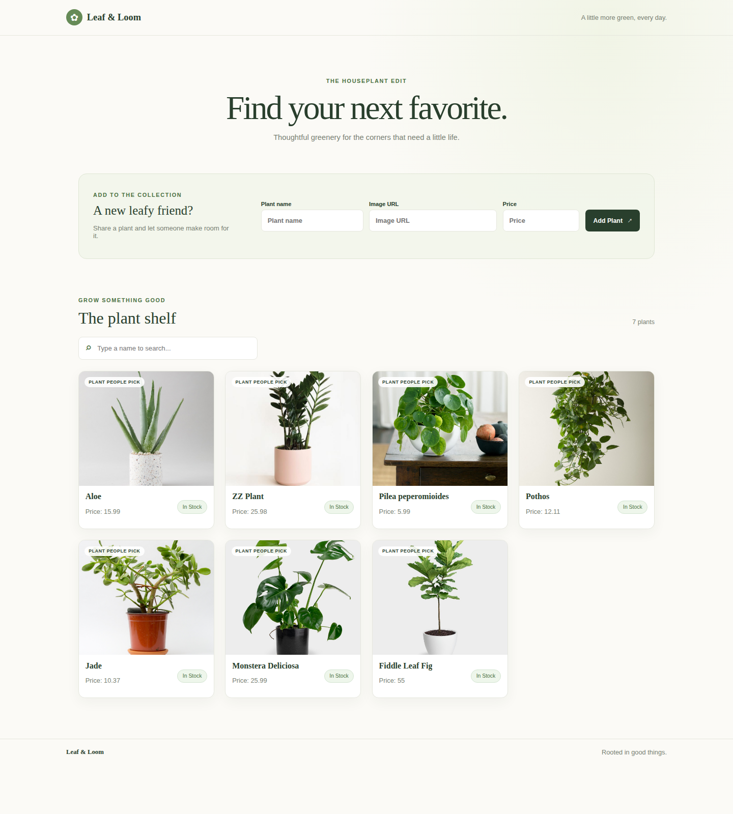

# Leaf & Loom

Leaf & Loom is a small plant-shop catalog for browsing a houseplant collection. It loads plant data from a JSON API and lets a shop manager add plants, mark them in or out of stock, and search by name.



## Features

- Loads plants from the backend when the page opens.
- Adds plants through the new-plant form and immediately shows the created plant.
- Toggles each plant between in-stock and sold-out states.
- Filters the catalog by plant name; clearing the search restores the full catalog.
- Shows loading, empty, and request-error messages.

## Requirements

- Node.js and npm.

## Run locally

1. In this directory, install dependencies:

   ```sh
   npm install
   ```
2. Start the app and API together:

   ```sh
   npm run dev
   ```
3. Open the local URL printed by Vite.

The included JSON Server backend listens on port `6001`. Its `GET /plants` endpoint returns the starter catalog in `db.json`. The plant form posts `name`, `image`, and the entered `price` to `POST /plants`, then adds the created plant to the page.

## Project scripts

| Command | Description |
| --- | --- |
| `npm run dev` | Start the JSON API and Vite development server together. |
| `npm run server` | Start only the JSON API on port `6001`. |
| `npm run build` | Create a production build in `dist/`. |
| `npm run preview` | Preview the production build locally. |
| `npm run lint` | Run ESLint. |

## Implementation notes

The API request and catalog state live in `src/App.jsx`. The form, search field, plant list, and plant card are separate components under `src/components/`.
